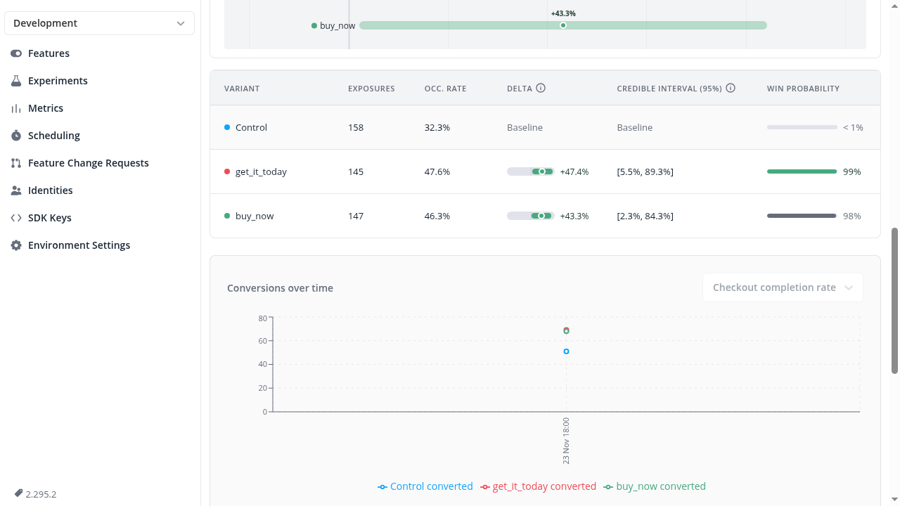

# FlagProof

**Feature flags interact. FlagProof proves where, with real Flagsmith writes and browser evidence you can review.**

A flag can pass every individual test and still break a checkout when combined with another flag. FlagProof connects to a real Flagsmith environment through the management API and browser SDK, exercises every on/off combination of your flags in a real browser against an independent price contract, and shows the smallest observed failing set with screenshots, Playwright traces and a JSON report. Every run requires a human to review and approve a hash-bound plan first; original flag state is recorded and restored with read-back verification.

Built for the Flagsmith Experimentation Hackathon (Toggle Wars), targeting the "Test Something Real" track: a full experiment designed, executed and read with statistical discipline on real Flagsmith infrastructure, plus an agent harness that drives Flagsmith with a human approving every change. AI assistance helped build this project; the capability table below states what is verified and what is not.

**Live demo:** <https://flagproof.onrender.com> runs the locked fixture-only public demo (no Flagsmith account needed). The recorded experiment analysis is at <https://flagproof.onrender.com/experiment/results>.

## How it uses Flagsmith

- **Management API**: writes each of the eight flag configurations to your environment, one at a time, through the official REST API.
- **Browser SDK**: the bundled demo checkout resolves flags through `flagsmith-js` against the live edge API, exactly as a real app would.
- **Experimentation**: a multivariate flag, per-visitor exposures and a conversion event drive a real Flagsmith experiment whose Bayesian analysis is read in the dashboard (see "Experiment mode" below).
- **Human approval**: no flag changes without a reviewed, hash-bound plan. A changed environment blocks the run.
- **Restoration**: after the matrix, original flag state is written back and read back to verify.

## Run it against your Flagsmith environment

Requirements: Node.js 22 or later, npm, and a Chromium browser. Tested with Node 22.23.4 and Google Chrome on Linux.

```sh
npm ci
npx playwright install chromium
npm run setup:flagsmith   # guided check of your environment + the three boolean flags
npm start
```

`setup:flagsmith` asks for a client-side environment key and a management API key (stored only in a local, gitignored `.env`, never printed back), verifies that the environment resolves and that three plain boolean flags exist: `new_checkout`, `express_shipping`, `promo_banner`. Create them in the Flagsmith dashboard first if missing (default OFF, no variants, no overrides).

Open the printed local address. The dashboard shows **FLAGSMITH API + SDK** mode.

## Try the proof

1. Keep **Seeded interaction defect** selected. Click **Prepare reviewable plan**.
2. Inspect the target, exact actions, assertions, JSON and SHA-256 fingerprint. Preparing or rejecting a plan changes no flags.
3. Click **Approve & run 8 cases**. A fresh Chromium context runs each configuration serially against the live flag state.
4. Expect **6 passes, 2 failures** on the seeded fixture (cases 04 and 08: `new_checkout` + `express_shipping` ON, with `promo_banner` OFF and ON), plus a fresh reproduction case that also fails. The observed minimal failing set is `new_checkout` + `express_shipping`. The expectation is the same in every mode: local private use, the offline bundled fixture, and the hosted public demo all run this identical bundled fixture, so the seeded outcome is 6/2 everywhere (verified live on the hosted demo 25 Nov 2026). Only the flag source differs: locally you can point the same suite at your own Flagsmith environment through the management API + SDK path, while the hosted demo is locked to the fixture and never touches Flagsmith.
5. Open a failed screenshot. The price is **$130**, but the independent contract is **$115**: a $100 item plus $15 express shipping. The fixture deliberately charges shipping twice for this pair. The promo flag is unrelated to the observed failure.
6. Check **Original flags restored and read-back verified**. Download the report, screenshots and traces.
7. Select **Healthy checkout control**, prepare a fresh plan and approve it. Expect **8 passes, 0 failures**, verified restoration.
8. Try **Reject** or **Cancel safely**. Cancellation waits for the current browser operation and cleanup.

No actual order or charge is made.

## Hosted public demo

`FLAGPROOF_PUBLIC=1` runs FlagProof as a locked public demo for hosted
evaluation. In this mode the bundled local fixture is forced on and live flag
providers stay off. Each visitor gets an isolated session, plans and runs are
visible only to the visit that created them, and suite starts are rate limited
per IP with a daily cap. Artifacts expire automatically.

Required: `PUBLIC_ORIGIN` (the public URL of the deployment).
Optional: `PUBLIC_DEMO_PASSWORD` (entry password; without it the demo is
open), `TRUST_PROXY=1` (only behind a proxy you control, so per IP limits see
real client IPs).

This mode is built for fixture-only hosted evaluation during the hackathon.
The protections above are covered by automated tests, but a public demo is
not production infrastructure and makes no production security guarantee.
Local private use is unchanged.

## Offline mode

Without `.env`, the app runs against a bundled local fixture adapter (clearly labelled LOCAL FIXTURE in the UI). Useful for trying the flow without a Flagsmith account; the Flagsmith-backed mode above is the primary path.

## The experiment (Track 01 entry)

Track 01 ("Test Something Real") asks for one experiment done well: a clear hypothesis, versions behind a flag, a metric from real events, and results you can explain. FlagProof's entry is a single checkout CTA experiment run once on real Flagsmith infrastructure with synthetic visitors, labelled synthetic everywhere it appears.

The hypothesis, fixed and hash-approved before any traffic ran:

> Changing the checkout CTA copy from "Checkout" to "Buy now" will increase checkout completion by at least 10 percentage points within the simulated traffic window.

- **Versions behind a flag.** `checkout_cta_copy`, a multivariate flag with three keyed variations created before any traffic: `control` 34%, `buy_now` 33%, `get_it_today` 33%. A bundled checkout page resolves the flag through the Flagsmith browser SDK and shows each visitor their variation, exactly as a real storefront experiment would.
- **A metric from real events.** Each visitor records an exposure through the SDK (`getExperimentFlag`) and a `checkout_completed` event at the moment of conversion (`trackEvent`), matched to a Flagsmith "Checkout completion rate" metric. Flagsmith's managed warehouse confirmed 638 events from the run: 450 exposures and 188 conversions.
- **Results you can explain.** Flagsmith's processed Bayesian analysis is quoted below with its credible intervals, and `node scripts/read-experiment-result.mjs test/fixtures/run-report-399.json` (the record path is required; the committed fixture is a byte-identical copy of the recorded run report) re-derives the decision read offline from the recorded run: whether each credible interval clears zero, whether the hypothesis's absolute threshold is established, the preset-versus-realized comparison, and the four wiring-validity checks. Threshold support reports **unknown** unless actual absolute-effect posterior evidence is recorded: multiplying a relative credible bound by the observed baseline is illustrative arithmetic, not a calibrated absolute-lift bound, and is labelled as such. Validity checks report **unknown** where the record does not contain the evidence; a documented checklist is not treated as machine-verified proof, and zero observed conversions reads as unknown (a valid possible outcome), not as broken tracking. No network calls.

On 23 Nov 2026 a single fixed 450-visitor synthetic run was executed, and Flagsmith's processed Bayesian analysis was verified on 24 Nov 2026. Control: 158 exposures at 32.3%. get_it_today: 145 at 47.6% (+47.4% delta, 95% credible interval [5.5%, 89.3%], 99% win probability). buy_now: 147 at 46.3% (+43.3%, [2.3%, 84.3%], 98%). Win probability is pairwise against control, not a ranking. Both intervals clear zero, so under Flagsmith's model both variations show a positive relative lift over control on this synthetic data; the absolute 10-point threshold in the hypothesis is not established by the reported intervals, and no direct challenger-vs-challenger comparison was established. These numbers demonstrate Flagsmith's analysis pipeline end to end on synthetic data; they say nothing about real users. The hosted demo also serves this recorded analysis at /experiment/results: a saved-results page that renders the repo's evidence record (byte-identical to the run report), labels deltas and intervals as relative, states that the absolute threshold stays unknown on this record, and never contacts Flagsmith.



The traffic CLI: `node scripts/run-experiment-traffic.mjs 450` drives synthetic visitors through the flag. Visitor identity is a deterministic hash, so the split is stable per visitor. Conversion outcomes come from preset per-variation probabilities: they are demo fixtures, not evidence that any CTA copy works better. The CLI also accepts `--flag`, `--event`, `--variants`, `--rates` and `--prefix` for validation runs such as an A/A plumbing check; these options are covered by tests against a local stub of the Flagsmith APIs.

The full write-up, including the four validity checks, preset-versus-realized rates and limitations, is in [EXPERIMENT-RESULTS.md](EXPERIMENT-RESULTS.md), with the dashboard screenshots and run record in [evidence/experiment-399/](evidence/experiment-399/). The experiment page is labelled synthetic in the UI.

## Agent experiment proposals

`node scripts/propose-experiment.mjs` drafts an experiment proposal (flag, metric, hypothesis, variations, traffic split) and prints a SHA-256 approval hash. Execution only proceeds when the operator pastes that exact hash; any other input cancels. The default execution records the approved proposal as a local fixture artifact. With `--live`, the operator must type a second explicit CREATE confirmation after the hash; the adapter then creates (or reuses an exact-match) metric and creates the experiment through the documented Flagsmith management REST endpoints, created stopped unless the operator separately types START. The multivariate flag with keyed variations must already exist; if anything is missing the adapter says what and changes nothing. Proposal generation, schema validation, hash-gated review and the live adapter's request sequence are covered by tests against stubbed API responses. The live path was also exercised once against a real Flagsmith organisation on 24 Nov 2026: it created a temporary flag and a stopped experiment, read them back, and cleaned everything up. A correction to the read-back check made after that run is validated offline and awaits one more live retest. An optional local Ollama model can draft the proposal text; human review stays mandatory either way.

## Self-hosted Flagsmith

`docker-compose.selfhosted.yml` is intended to run Flagsmith and Postgres locally alongside FlagProof, so the whole flow can run without a Flagsmith Cloud account:

```sh
docker compose -f docker-compose.selfhosted.yml --profile flagproof up
```

Requires Docker with Compose v2. This file is written but not yet runtime-verified at any level. A first `docker compose up` would only verify level 1, that the services boot and become reachable. Calling the self-hosted path "tested" additionally needs level 2 (the FlagProof app passing its checks against the self-hosted Flagsmith) and level 3 (the experiment flow running against it). None of the three levels has been run yet.

## What is working, and what is not

| Capability | Status |
| --- | --- |
| Local checkout and three boolean flags | Working and browser-tested |
| Exact eight-configuration matrix | Working |
| Manual-template plan, strict schema, hash-bound approval and rejection | Working |
| Real Flagsmith management API writes and browser SDK resolution | **Verified in an isolated disposable demo environment**: seeded 6/8 pass + reproduction; healthy 8/8 pass; restored OFF |
| Real checkout clicks, independent assertions, console/page-error capture | Working |
| Screenshot, Playwright trace and JSON report per case | Working |
| Observed minimal set and fresh reproduction | Working for the seeded fixture |
| Restoration with read-back, cancellation and explicit failed-cleanup state | Tested locally, including injected failures |
| Durable history, interruption detection, compatible-run comparison, readable Markdown evidence reports | Working and browser-tested |
| Synthetic experiment traffic (exposures and conversions) against a live Flagsmith experiment | **Verified 23 Nov 2026**: one fixed 450-visitor synthetic run, 638 events confirmed in the managed warehouse; Flagsmith's Bayesian analysis verified 24 Nov 2026 with 95% credible intervals ([5.5%, 89.3%] and [2.3%, 84.3%], both clearing zero) |
| A/A validation options on the traffic CLI (custom flag, identical variations, equal preset rates) | Tested end to end against a local stub of the Flagsmith APIs; no live A/A run yet |
| Offline experiment result reader (interval read, threshold support bounded to recorded posterior evidence, preset-vs-realized, evidence-bounded validity checks) | Working and tested against the recorded experiment-399 run and synthetic fixtures |
| Agent experiment proposal with hash-gated human approval and fixture execution | Working and tested |
| Live experiment creation adapter (management REST; create-only unless separately confirmed) | Tested against stubbed API responses, and exercised once against a real organisation 24 Nov 2026 (temporary flag and stopped experiment created, read back, cleaned up; read-back correction validated offline, one live retest pending) |
| Self-hosted Flagsmith compose file | Written, not runtime-verified at any level (boot, integration and experiment checks all outstanding) |
| Responsive dashboard at 320, 390, 1280 and 1440 px | Checked in Chromium |
| AI-generated plan using a local Ollama model | **Verified with qwen2.5:0.5b on 20 Nov 2026 across both bundled fixtures** (schema-checked plans, scenario guard, explicit failure, no silent fallback). Other models untested; review stays mandatory. |
| AI-authored result explanation | **Not implemented**. The summary is deterministic. |
| Hosted public demo mode (locked fixture-only serving, per-visitor isolated sessions, per-IP rate limits with daily cap, expiring artifacts, optional entry password) | Implemented and covered by automated tests; deployed on Render and verified live 25 Nov 2026; a demo, not production infrastructure |
| Production app targeting and CI | **Not implemented** |

The verified Flagsmith run covered the selected disposable environment only: plain boolean flags, no overrides, one writer. It is not proof of safety for arbitrary accounts, other flag types, concurrent writers or production use.

## Safety boundary

- The only target is the bundled local checkout. Plans cannot add outside URLs, arbitrary actions, scripts or shell commands.
- Every plan is schema-validated, reviewed and hash-bound. A changed initial state blocks execution until a fresh review.
- The loopback API checks Host, Origin and a per-process action token. It is not a remotely deployable authentication system.
- Management keys stay server-side in the gitignored `.env`; the browser only ever sees the public environment key.
- Each run records its original flag state before writes, checks management read-back, checks browser-resolved booleans, and attempts restoration in `finally`.
- Behind `TRUST_PROXY`, per-IP rate limits key on the rightmost X-Forwarded-For entry supplied by the trusted proxy, and browser runner tickets are scoped to the run that issued them.
- A setup mismatch is **invalid**, not a passing test. A failed restoration changes the overall run to **error**.
- No code can guarantee cleanup after a power loss or forced process kill. Reports are written throughout the run.
- Test cases are browser measurements against an intentionally synthetic defect. The failure itself is seeded; screenshots and assertion outcomes are not fabricated.
- A minimal set is an observed set whose every proper subset passed in this matrix. It is not proof of root cause. A green result only covers this journey and these configurations.

## Tests

```sh
npm test
```

One hundred and five automated tests cover matrix/schema logic, subset evidence rules, API review guards, CSRF/origin checks, concurrent approvals, actual seeded/healthy browser runs, non-default-state restoration, cancellation, invalid setup and failed cleanup, the Flagsmith adapter and SDK bundle against simulated responses, the guided setup checks (flag discovery, override/variant/malformed rejection, key routing, `.env` handling and secret-leakage guards), the AI planner against mocked model responses: valid-plan acceptance, schema-violation rejection, scenario-change rejection, explicit API failure with no silent fallback, and the manual path never calling the model, the experiment helpers (deterministic identity hashing and fixture conversion), the traffic CLI end to end against a local stub of the Flagsmith APIs including the A/A options, and the agent proposal flow (schema validation, review, hash-gating and the live adapter's request sequence), and the experiment result reader (interval reading, hypothesis-threshold support, preset-versus-realized comparison and evidence-bounded validity checks that report unknown where the record is insufficient), and the saved-results page (record rendering, relative-labelled headers, unknown-status threshold wording and the recorded detail panel).

## Provenance

Built 17-18 November 2026, before the hackathon window, as a pre-event prototype; the Flagsmith integration was verified against a disposable demo environment during those dates. Event eligibility is the organizers' call and is not claimed here. Git history is intact and unrewritten. Experiment, agent-proposal and self-hosting additions were built 23-24 November 2026.
